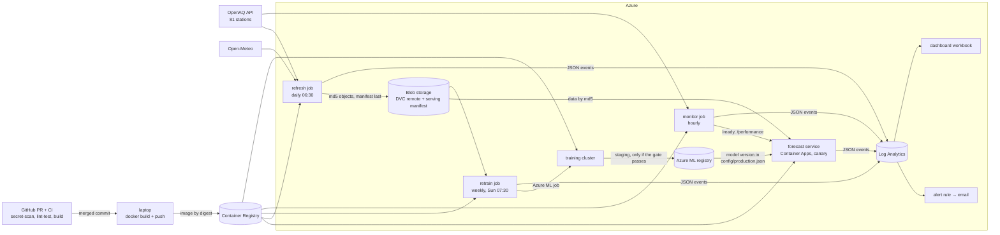

# Next-day PM2.5 forecast for Bangkok

ITCS355 MLOps capstone · Bhornpailin Chunkasut (6688020)

Forecasts each Bangkok air-quality station's PM2.5 for the next day. A daily job (06:30) brings in the previous day's complete data; the API computes forecasts on request from the latest data, with the same code as training.

## Architecture



Everything runs as its own least-privilege managed identity (see Identities). Code and models reach production only through a merged pull request, CI and a canary; data changes only through the refresh job, which fails closed. Only the refresh job can write data.

## Documents

| | |
|---|---|
| Model card (what the model is, how it was evaluated, its limits) | `docs/model-card.md` |
| Data findings (the rules behind every check) | `docs/data-findings.md` |
| Post-mortem: stale serving data, Oct 15–17 | `reports/postmortem-2026-10-16-stale-data.md` |
| Cost report (actual spend and monthly estimate) | `reports/cost-report.md` |
| Model selection study | `reports/study-comparison.md` |
| Canary, retraining and load-test reports | `reports/` |

## Data

- **PM2.5:** Pollution Control Department of Thailand (Air4Thai), via the OpenAQ API v3.
  81 stations (rule in `scripts/make_stations.py`). Hourly values are 24-hour moving
  averages, so the daily target is the 23:00 reading (`docs/data-findings.md`, Finding 7).
- **Weather:** Open-Meteo Previous Runs API (CC BY 4.0), day-2 forecasts. Currently not a
  model input because of drift between years (Finding 8); kept as a monitored signal.
- **Versioning:** DVC, remote on Azure Blob (`.dvc/config`). `dvc pull` restores the exact data.

## Model selection

Selected: **study-17**, gradient-boosted trees predicting the day-to-day change,
absolute-error loss, learning rate 0.03, 15 leaves, min 200 rows per leaf, and the
predicted change scaled by 0.25 toward persistence. Selection rule, fixed before the study:
the lowest validation MAE among trials passing all four gate checks on validation (the
2024–25 dry season). The top validation score (k = 0.5, MAE 5.843) was not chosen: it
missed the recall check by 0.3 points. Three trials passed the gate on the test year but not
on validation; none were chosen, since selecting on test would make the test meaningless.
**Seed variance:** not zero. With more than 10,000 training rows, scikit-learn's `HistGradientBoostingRegressor` turns on early stopping automatically, and the seed chooses its random 10% hold-out. Five seeds of study-17 (20260101, 1–4) give val MAE 5.901 ± 0.028 (range 5.877–5.946) and test MAE 3.964 ± 0.009 (3.952–3.976); all five pass both gates. The worst seed still beats persistence (val 6.14, test 4.12), so the improvement is not seed luck. The registered seed (20260101) was fixed before the study.
**How narrow the selection was:** study-17 was the only trial to pass the validation gate. study-18 (k=0.5) had lower val MAE (5.843 vs 5.889) but recall 0.734, just below persistence's 0.737; study-17's 0.739 passed by 0.002. Both margins are within seed noise, so the choice between them is narrow. study-17 passed the gate with all five seeds. The rule (best val MAE among gate-passers) and the seed were fixed before the study, and we did not re-run study-18 under other seeds to change the outcome — that would be selecting on results. Cost of the choice: lower onset recall (0.075 vs 0.121), i.e. slower to catch the first day of an episode.
**Cost:** a full fit takes about a minute on a laptop; weekly retraining costs about 0.25 USD a
month on the training cluster (`reports/cost-report.md`). **How this could be wrong:** the margin over persistence is small (MAE −4%, recall +0.2 points), validation covers one dry season, and station-days are correlated, so the improvement may be partly noise. The model is mostly persistence and catches few
pollution onsets (7%).

Full comparison: `reports/study-comparison.md` · experiment `pm25-study` in Azure ML.

## Evaluation gate

A model is used only if, against persistence ("tomorrow = today") on the same rows, it has
lower MAE, lower dry-season MAE, recall on days > 37.5 µg/m³ at least as high, and a
false-alarm rate no higher (`src/evaluate.py`). If nothing passes, persistence stays in service.

## Identities (least privilege)

Every component runs as its own managed identity with only the roles it needs. No component holds a password or key; the one external secret (the OpenAQ key) is a Key Vault reference.

| Identity | Used by | Roles (scope) | Cannot |
|---|---|---|---|
| training cluster (system-assigned) | Azure ML training jobs | AcrPull (registry) · Storage Blob Data Reader (storage) | write data, push images |
| `itcs3556688020-serve` | forecast service | AcrPull · Storage Blob Data Reader · AzureML Data Scientist (workspace, to load the model) | write data |
| `itcs3556688020-monitor` | hourly monitor | AcrPull · Key Vault Secrets User on **one** secret (`openaq-api-key`) | touch data at all |
| `itcs3556688020-refresh` | daily refresh | AcrPull · that one secret · Storage Blob Data **Contributor** (container `itcs355`) | anything outside that container |
| `itcs3556688020-retrain` | weekly retraining | AcrPull · AzureML Data Scientist · Storage Blob Data Reader | write data, change production |

Evidence: before `AcrPull` was granted, the first training job failed with "Failed to pull Docker image … could not authenticate with the Docker registry" (job `gray_lizard_1nk701bx42`). The registry's admin password was deliberately never enabled: one shared credential with full access is the opposite of least privilege.

## Promotion (staging → production)

- **Staging:** `scripts/register.py` registers a version only if the run passed the gate and has complete lineage; it is tagged `stage: staging`. The registry holds *candidates*.
- **Production:** the version that serves is whatever `config/production.json` names. That file is the single source of truth.
- **How to promote:** `python scripts/promote.py --version N --reason "..."` refuses versions without full lineage or not in staging, then rewrites the file. The change reaches production only by a merged pull request (first promotion: PR #1).
- **Who may promote:** anyone may open the PR; merging is the approval. Here the single author approves; in a team, branch protection would require a second reviewer and passing CI.
- **Rollback:** revert the promotion commit. `previous_version` in the file records what to fall back to.

## How to run

**Prerequisites:** Python 3.11, Docker, Azure CLI (`az login`), access to the resource group.

```powershell
python -m venv .venv; .venv\Scripts\Activate.ps1
pip install --require-hashes -r requirements.txt   # the same hashed lock CI installs
copy cloud.env.example cloud.env                   # fill in the capability slots (never committed)
copy .env.example .env                             # OpenAQ key, only for local runs (never committed)
python scripts/cloud_check.py                      # every slot resolves
dvc pull                                           # the exact data versions named in data/*.dvc
ruff check . ; python -m pytest -q                 # the same checks as CI
```

| Locally | Command |
|---|---|
| Serve | `uvicorn src.service:app --port 8000`, then http://localhost:8000/docs |
| Train study-17 | `python -m src.train --target-mode delta --features no_weather --loss absolute_error --learning-rate 0.03 --min-samples-leaf 200 --max-leaf-nodes 15 --shrink 0.25` |
| Refresh data, dry run | `python -m src.refresh --dry-run` |
| Monitor once / replay an incident | `python scripts/monitor_run.py` · `--replay tests/fixtures/bang_sue_frozen_2023-09.csv` |

**In Azure.** Every change goes PR → CI → merge first; everything is deployed **by image digest**.

```powershell
az acr login -n <registry>
docker build -t <registry>.azurecr.io/itcs355:<commit> . ; docker push <registry>.azurecr.io/itcs355:<commit>
$img = docker inspect --format "{{index .RepoDigests 0}}" <registry>.azurecr.io/itcs355:<commit>

python scripts/train_remote.py --image $img                 # train (Azure ML job, training cluster)
python scripts/register.py --run <run id>                    # staging, only with gate + full lineage
python scripts/promote.py --version N --reason "..."         # rewrites config/production.json -> pull request

python scripts/deploy_service.py --image $img --canary 20    # new revision with 20% of traffic
python scripts/canary.py ; python scripts/canary.py --apply  # decide by the written rule, then apply

python scripts/deploy_refresh.py --image $img                # daily refresh job
python scripts/deploy_monitor.py --image $img                # hourly monitor job
python scripts/deploy_retrain.py --image $img                # weekly retraining job
python scripts/create_alerts.py                              # alert rule + email action group
python scripts/create_dashboard.py                           # operations dashboard
```

### One-time cloud setup

The resource group, registry, storage account and Azure ML workspace come from the course labs and are named in `cloud.env`. On top of them:

- **Training cluster:** `python scripts/create_compute.py`.
- **Container Apps environment:** `az containerapp env create -g <rg> -n itcs3556688020-env -l southeastasia --environment-mode ConsumptionOnly`. It must be ConsumptionOnly: the express default cannot run two revisions, so it cannot canary.
- **Key Vault** `itcs3556688020-kv` with the secret `openaq-api-key`, entered in the portal, never in a terminal.
- **Identities:** for each row of the Identities table, `az identity create -g <rg> -n <name>`, then one `az role assignment create --assignee-object-id <principalId> --assignee-principal-type ServicePrincipal --role "<role>" --scope <scope>` per role, at the narrowest scope listed.

## Serving cost

From `scripts/cost_serving.py` (Azure Retail Prices API, Container Apps Consumption, southeastasia; replica 0.5 vCPU / 1 GiB; throughput 39.3 req/s from the load test) — full table in `reports/cost-serving.md`:

- **1,000 predictions: ~$0.0009.** The work itself is nearly free.
- **What costs money is replicas existing:** one wake-up from zero ≈ $0.0063 (the replica stays for the 300 s cooldown); one replica kept warm all day ≈ $0.52 (~$15.50/month) even with zero requests.
- **Decision: scale to zero by default.** The forecast changes once a day and traffic is light; the monthly free grant covers ~100 active replica-hours, so realistic use costs ~$0. Trade-off: a 20–40 s cold start for the first request after a quiet period. `minReplicas 1` only for load tests and the live demo.
- **Lesson learned:** `minReplicas` belongs to a *revision*. A revision kept warm for the load test kept a replica running after traffic moved away, until it was explicitly deactivated.

## Deployment and canary

- **Deploy by digest** (`scripts/deploy_service.py`): one image for training and serving; refuses tags. Azure Container Apps (standard, ConsumptionOnly environment — the new *express* default cannot run two revisions, so it cannot canary). Revision name = model version + image digest + deploy time.
- **Canary**: `--canary N` creates the new revision with N% of traffic *in the same request* (10% for the first canaries, 20% later), so no user ever sees an untested revision at 100%.
- **Decision by written rule** (`scripts/canary.py`): promote only if the candidate served ≥ 20 requests, its error rate ≤ stable's, its p95 ≤ 500 ms, and — for the same model version — it returns **exactly the same forecast for every station**. Otherwise roll back. Errors that cannot be attributed to a revision count against the candidate. Latency is checked against the absolute target, not against stable: at 90/10 or 80/20 the stable revision queues more and always looks slower.
- **Evidence:**
  - Good candidate `488ae00` (structured logging): 0 errors, p95 73 ms, 39/39 forecasts identical → **promoted** (`reports/canary-m1-488ae00-10151536.md`).
  - Bad candidate `aa288ab` (branch `demo/bad-canary`, never merged: `shrink` not passed to `forecast.predict`): 0 errors, p95 75 ms — looked perfect — but **0/54 forecasts matched** → **rolled back in 14.8 s** (`reports/canary-m1-aa288ab-10151621.md`).
- **Defence in depth:** the same bug fails 3 unit tests (safety net 1: tests/CI before merge); the canary is safety net 2, in production, for what tests miss.


## Calling the service

Base URL: `https://itcs3556688020-forecast.agreeableforest-9e3a5ae0.southeastasia.azurecontainerapps.io`
(scales to zero: the first request after a quiet period takes ~20–40 s while the model loads).

| Endpoint | Purpose |
|---|---|
| `GET /health` | process alive (liveness) |
| `GET /ready` | model + data loaded (readiness): model version, data version, data age, revision, image |
| `GET /performance` | the serving model's own forecasts for the last 14 days with known actuals, next to persistence (used by the monitor) |
| `POST /predict` | `{"station_id": "135"}` → tomorrow's PM2.5 for one station |
| `POST /predict/batch` | `{"station_ids": ["135", "200"]}`, or `{}` for every station |

```bash
curl -s https://<base-url>/ready
curl -s -X POST https://<base-url>/predict -H "Content-Type: application/json" -d '{"station_id":"135"}'
```

Example response:

```json
{"station_id": "135", "forecast_date": "2026-10-12", "pm25_forecast": 15.9, "yesterday_pm25": 15.4,
 "unhealthy": false, "threshold": 37.5, "model": "pm25-forecast", "model_version": "1",
 "revision": "itcs3556688020-forecast--m1-488ae00-10151536"}
```

Unknown station → 404; malformed body → 422; model not loaded yet → 503. Every response carries an `x-revision` header.
Interactive docs: `/docs`.


## CI (`.github/workflows/ci.yml`)

Every pull request to `main`, and every push to `main`, runs three checks:

- **secret-scan** — gitleaks over the **whole history** (`fetch-depth: 0`): a key deleted later is still in old commits.
- **lint-test** — installs the hashed lock (`pip install --require-hashes`), `ruff check` (rules pinned in `ruff.toml`), `pytest`.
- **build** — `docker build`, only after lint-test passes.

The job token is read-only (`permissions: contents: read`).

**Deliberately bad PRs, both caught by the responsible check and closed unmerged:**
- PR #3 — a private key committed: **secret-scan failed**. A first attempt with an obviously fake key ("demo", "fake") was *not* flagged — gitleaks ignores placeholders — so the test was redone with a real-format throwaway key that was never registered anywhere. A check is only trusted after it has been seen to fail.
- PR #4 — `shrink` not passed to `forecast.predict`: **lint-test failed** (3 tests), build skipped.

**Enforcement:** ruleset `protect-main` requires a PR and all three checks, with no bypass, and is enforced (GitHub Student Developer Pack, since 2026-10-24).

## Monitoring

### What is checked (`src/monitor.py`)

Thresholds reuse `src/checks.py`; each is tied to a finding in `docs/data-findings.md`.

| Check | Fires when | Severity |
|---|---|---|
| `stale_data` | the data behind today's forecast is more than 1 day old (from `/ready`) | critical |
| `feed_outage` | fewer than half the stations reported in the last 3 h (Finding 1) | critical |
| `stuck_sensor` | a station's **latest** reading ends a run of ≥ 8 identical hours (Finding 4: longest healthy run 7 h) | warning |
| `service_unreachable` / `service_not_ready` | `/ready` cannot be reached, or does not return 200 | critical |
| `model_vs_persistence` | the serving model's MAE over the last 14 days with known actuals is worse than persistence's (from `/performance`: the model backtests itself on every data reload) | warning |

One owner per problem: a station that stopped reporting is a `feed_outage`, not a `stuck_sensor`, so one failure never raises three alerts.

### How it runs

- `scripts/monitor_run.py` runs as an hourly **Azure Container Apps Job** `itcs3556688020-monitor` (cron `5 * * * *` UTC), using the same image as the service. Each run fetches the last 48 h for all 81 stations from OpenAQ (about 4 min, within the API rate limit), calls `/ready` and `/performance`, and writes **one JSON line per finding**.
- **Exit code 0 means the monitor ran**, with or without findings. A *failed execution* means the monitor itself broke. These are two different alarms, kept apart.
- `--replay <csv>` feeds a recorded incident through the same check; its findings are labelled `mode = replay`.

### Secrets and identity

The OpenAQ key lives in **Key Vault** `itcs3556688020-kv` (entered in the portal, never in a terminal, file or script). The job definition holds only a reference to it. The job runs as `itcs3556688020-monitor`, which can do exactly two things: pull the image (AcrPull) and read that **one** secret (Key Vault Secrets User on `openaq-api-key`). It cannot touch data. All identities: see **Identities** above.

### Alerting

JSON findings → Log Analytics (`workspace-itcs3556688020DG3A`) → log alert `pm25-monitor-finding` (every 15 min over a 2-hour window, split by check, severity and mode) → action group `pm25-oncall` → email. Created by `scripts/create_alerts.py`; the recipient comes from `cloud.env` and is not committed.
The alert is **stateful**: one email when a finding appears and one when it clears. The 2-hour window is longer than the hourly cadence plus ingestion delay, so the alert does not flap between runs.

Querying findings (workspace → Logs):

```kusto
ContainerAppConsoleLogs_CL
| where Log_s startswith "{"
| extend e = parse_json(Log_s)
| where e.event == "finding"
| project TimeGenerated, check = tostring(e.check), severity = tostring(e.severity),
          mode = tostring(e.mode), message = tostring(e.message)
```

### Evidence (2026-10-15 to 18)

- **First live run, a true positive:** `stale_data` critical, *"forecast uses data 5 days old"*. The service still used the Oct 11 snapshot. Alert email at 21:02. Fix: the daily data refresh.
- **Frozen-sensor demo:** the real Bang Sue freeze (Sep 2023, stuck at 15.0) replayed in the cloud at 21:17. `stuck_sensor`, `mode = replay`, alert email at 21:32: **about 15 min from finding to email**.
- **The first cloud replay failed** (`FileNotFoundError`: the recorded incident was not in the image). It was diagnosed from the job's logs in Log Analytics and fixed by adding `tests/fixtures/` to the image; the replay then succeeded. That Dockerfile fix was later found to have been committed after its PR was merged, so it never reached `main` until it was cherry-picked (see the post-mortem).
- `model_vs_persistence` (live since Oct 18): Oct 4–17, 1,061 station-days, model MAE 4.679 vs persistence 4.995 (−6.3%), consistent with the test year (−3.5%); no finding. Checked hourly by the monitor.
- Service SLOs measured per day on the dashboard (Oct 15, 17, 18; 2,162 requests): 0 server errors (availability 100%); worst daily p95 latency 139 ms (server-side) against the 500 ms target.


### Service-level objectives (targets)

| SLO | Target | Why |
|---|---|---|
| Availability | ≥ 99% of `/predict` requests return a non-5xx response, over 7 days | users of a daily forecast tolerate rare retries, not outages |
| Latency | ≥ 95% of `/predict` requests complete in ≤ 500 ms | the load-test target; met at concurrency ≤ 10 |
| Freshness | the forecast's data is ≤ 1 day old in ≥ 99% of hours | a forecast from stale data is silently wrong |
| Detection | data problems are alerted within 30 min of the monitor run that finds them | measured at ~15 min in the replay |

- Freshness SLO (data ≤ 1 day old): met since Oct 17 19:03 (daily refresh, see below); it was violated Oct 16–17 (`stale_data` incident).

### Not yet wired

- No alert yet on **failed monitor executions** (a broken monitor would currently go unnoticed).
- Email subjects are the same for every check; one rule per check would put the problem in the subject line.


## Daily data refresh

The forecast needs yesterday's readings. A daily job brings them in, so serving data is never more than a day old.

**Schedule:** Container Apps Job `itcs3556688020-refresh`, every day at 06:30 Bangkok (`30 23 * * *` UTC), when yesterday is complete.

**What one run does** (`python -m src.refresh`):
1. Reads the current serving data: the version named in the manifest, or the committed DVC pointer if there is no manifest yet. Every download is verified by md5.
2. Re-fetches the last 10 whole days from OpenAQ (81 stations) and the weather API. Re-fetching a window, not just yesterday, picks up readings OpenAQ publishes late.
3. Builds daily rows with **the same functions as training** (`ingest.hourly_series`, `target.daily_target`, `weather.daily_features`) and replaces those days in `targets.csv` and `weather_daily.csv`.
4. Uploads both files to the DVC remote **by md5** (content-addressed, never overwritten), then writes the manifest (blob `capstone/serving/current.json`, not in the repo) **last**:
```json
   {"built_at": "...", "window": ["2026-10-07", "2026-10-17"],
    "base":  {"from": "pointer", "targets.csv": "85a15b41...", ...},
    "files": {"targets.csv": {"md5": "57428101...", "rows": 58031, "last_date": "2026-10-16"}, ...},
    "stations": 81, "stations_failed": []}
```

**Fails closed.** Nothing is published, and the run exits 1, if more than 20% of stations fail, if a file comes out with different columns, or if it has fewer rows than before. Because the manifest is written last, a failed run never leaves the service pointing at half-published data. The old data stays in place, and the `stale_data` check alerts if refreshes keep failing.

**How the service picks it up.** The service reads the manifest at startup and re-checks it every hour (`DATA_CHECK_SECONDS`, default 3600). When the md5 changes, it rebuilds only the feature rows and swaps them in with a single assignment; the model is never reloaded. A failed check keeps serving the old data and reports `data_check_error` in `/ready`. `/ready` shows `data_from` (`manifest` or `pointer`) and `data_version` (md5 of `targets.csv`), and every prediction log line carries `data_version`.

**Lineage.** The training data stays pinned in git (`data/*.dvc`) and recorded with each model. Serving data is versioned by the manifest: `base` names the version it was built from, and `files` names what it produced. Either can be fetched from the DVC remote by md5.

| Identity | Can | Cannot |
|---|---|---|
| `itcs3556688020-refresh` | AcrPull · Key Vault Secrets User on `openaq-api-key` only · Storage Blob Data **Contributor** on container `itcs355` | anything else in the subscription |
| `itcs3556688020-serve` | read data (Storage Blob Data **Reader**) | write data |
| `itcs3556688020-monitor` | read the one secret | touch data at all |

The refresh job is the only component that can write data.

**Run it**
```powershell
python -m src.refresh --dry-run                          # locally: data/ in, build/refresh/ out, nothing uploaded
python scripts/deploy_refresh.py --image <registry>.azurecr.io/itcs355@sha256:...   # create/update the job (digest only)
python scripts/deploy_refresh.py --run-now --dry-run     # in the cloud: reads blob storage, uploads nothing
python scripts/deploy_refresh.py --run-now               # one real refresh now
python scripts/deploy_refresh.py --run-now --days 14     # re-fetch a longer window once (after an outage)
```

**Evidence (Oct 16–18)**
- **Same code as training:** a local dry run re-derived 461 station-days that `ingest build` had already computed: 461/461 identical (max difference 0.0).
- **Code first, data second:** the service's data-reload code was canaried while no manifest existed, so both revisions served the same data. Result: 70/70 identical forecasts, promoted (`reports/canary-m1-7f6189f-10171836.md`). Only then was data published, so the canary judged the code alone.
- **First publish:** Oct 17 19:03. `/ready` then showed `data_from: manifest`, `data_age_days: 1` (was 6).
- **Incident closed:** the `stale_data` alert (fired Oct 16 21:02) resolved automatically on Oct 17 at 20:48.
- **First scheduled run:** Oct 18 06:30. `/ready` showed a new `data_version` with no redeploy.

**Known limits**
- Storage RBAC is granted per container, and the training data lives in the same container. Writes are protected by the code (only new md5-named objects plus the one manifest) and by md5 verification on every read. An Azure ABAC condition restricting writes to `capstone/serving/` would enforce it in the platform.
- No alert on a failed refresh execution yet. A failed run is caught indirectly by `stale_data` once the data ages.
- Stations with no reading yesterday (4 of 81 on Oct 16) have no feature row, so `/predict` returns 404 for them instead of guessing.


## Weekly retraining (with a gate)

**Why retrain at all.** Production v1 was fitted on data up to 2025-09 (`split.py`: everything after the test year is unused). It has never seen the 2025–26 dry season. A retraining pipeline lets new data in, but only through a gate.

**Schedule:** Container Apps Job `itcs3556688020-retrain`, Sundays 07:30 Bangkok (`30 0 * * 0` UTC), an hour after that day's data refresh.

**One run** (`scripts/retrain.py`):
1. Reads the serving manifest: the challenger trains on the same refreshed data the service uses. The md5 is checked inside the job and recorded as the run's data version.
2. Submits an Azure ML job on the training cluster (`src/retrain.py`, same image and the same study-17 settings as v1, taken from `train_remote.py`). It fits **5 seeds** on all rows ending 7 days before the window.
3. Scores production (the version in `config/production.json`, loaded from the registry like the service does) on **the same rows**: same data version, same feature code, same window rule. If the row counts differ, it refuses to compare.
4. Applies the gate. **Pass:** registers the model of the pre-fixed seed (20260101) as `staging` with full lineage. **Fail:** registers nothing. Either way it writes `reports/retrain-<date>.md`, logs it to the MLflow run, and emits one `retrain` JSON event.

**The window.** The last 28 days. Neither model has seen them: the challenger stops 7 days before (the lag inputs reach back 7 days), and v1 stops in 2025-09. *Trade-off:* a 365-day window would always include a dry season, but then the challenger could only learn from the same data as v1, so retraining would be pointless for a year. So checks the window cannot judge are reported **n/a**, never faked:
- no dry-season days → `mae_dry` is n/a;
- fewer than 20 station-days above 37.5 → recall is n/a (a handful of isolated spikes, caught by nobody, would give a meaningless 0 ≥ 0).

**Gate.** All judged checks must pass, and at least one must be judged.

| vs | Check |
|---|---|
| persistence | the four checks of `src/evaluate.py` (MAE, dry-season MAE, recall, false alarms) |
| production | mean MAE over 5 seeds ≤ production MAE − **0.056** (2 × the seed SD from the study-17 seed check) |
| production | **every** seed's MAE < production MAE |
| production | recall on days > 37.5 not below production's |

**Promotion stays human.** A `staging` model reaches production only through `scripts/promote.py` → pull request → CI → canary, exactly like v1. The model registered is the one that was scored; it is not refit on the window afterwards, because then the shipped model would not be the tested one.

**Identity** `itcs3556688020-retrain`: AcrPull · AzureML Data Scientist (workspace) · Storage Blob Data **Reader** (data container). It can propose a model, but it can neither write data nor change production.

**Run it**
```powershell
python scripts/retrain.py --image <registry>.azurecr.io/itcs355@sha256:...        # from a laptop (clean commit)
python scripts/retrain.py --image ... --no-register                    # judge only
python scripts/deploy_retrain.py --image <registry>.azurecr.io/itcs355@sha256:...  # schedule (clean commit)
python scripts/deploy_retrain.py --run-now
```

**Evidence (2026-10-18, first run): REJECTED** (`reports/retrain-2026-10-18.md`)

| Sep 20 – Oct 17, 2,084 station-days | MAE |
|---|---|
| persistence | 4.186 |
| challenger, 5 seeds | 4.035 – 4.079 (mean 4.060) |
| **production v1** | **3.988** |

Both models beat persistence, but v1 was better, and all 5 seeds of the challenger were worse. So the gate kept v1, and production was unchanged. More data did not mean a better model on this month: without a gate, a weekly schedule would have quietly made the service worse.

**Known limits**
- One 28-day window is small evidence. The margin and the every-seed rule guard against seed noise, not against an unusual month. A rejected challenger costs only a week; a wrongly promoted one would cost forecasts, so the gate errs towards keeping production.
- In the rainy season the gate effectively judges MAE and false alarms only; dry-season checks apply from November.
- A failed weekly run alerts nobody yet (same gap as the refresh job). Production is unaffected, because nothing changes without a pass and a PR.

## Dashboard

`python scripts/create_dashboard.py` creates (or updates) the Azure Monitor Workbook **PM2.5 forecast - operations**. The six tiles are defined in that script as KQL queries over the events the system already logs, so the dashboard is rebuilt from the repo, not clicked together:

| Tile | Event | Shows |
|---|---|---|
| Traffic | `request` | requests and 5xx per hour (0 when idle) |
| Service SLOs per day | `request` | requests, errors, availability %, p50/p95 latency, SLO met |
| Model quality | `model_performance` | serving model vs persistence MAE, hourly |
| Data freshness | `refresh` | each daily refresh: last date, age, rows, failed stations |
| Monitor findings | `finding` | findings per day by check (replays labelled) |
| Retraining | `retrain` | weekly gate decisions with challenger / production / persistence MAE |

Not shown on purpose: the distribution of served forecasts. Logged predictions cover only stations someone called (mostly canary and load tests), so they would describe our testing, not Bangkok's air.


## Questions from the defence (2026-10-24)

### A station reads implausibly low, or loses data, in the dry season
- **Missing data is handled today.** A station with no reading yesterday has no feature row, so `/predict` returns 404 instead of guessing (4 of 81 stations on Oct 16). If more than 20% of stations fail, the daily refresh publishes nothing and the old data keeps serving; fewer than half the stations reporting in 3 hours raises `feed_outage` (critical).
- **A reading that is present but implausible is NOT caught today.** `stuck_sensor` catches a sensor that stops changing; it does not catch one that reads, say, 12 µg/m³ while its neighbours read 80.
- **What I would add:** a `neighbour_disagreement` check in `src/monitor.py`: compare each station's latest value with the median of the stations within 10 km, and raise a warning when it stays far outside that range for several hours while at least 3 neighbours report. The exact limits would come from the history, the way Finding 4 set the 8-hour stuck rule.
- **What the team does:** the alert arrives by email (below) → check the station on Air4Thai → if it is faulty, add it to an exclusion list in `config/` through a pull request, so the refresh and retraining skip it and `/predict` returns 404 for it instead of a wrong forecast → remove it when the station recovers.

### A broken sensor: how the data science team is told
`stuck_sensor` (8 or more identical hours) → one JSON finding → Log Analytics → alert rule `pm25-monitor-finding` (every 15 min, split by check, severity and mode) → action group `pm25-oncall` → email. Measured: about 15 minutes from finding to email. Reaching a whole team is a settings change, not a code change: add their addresses, or a Teams or Slack webhook, to the action group.

### Cost of one training run
| Run | Where | Time | Cost |
|---|---|---|---|
| One fit of study-17 | laptop | about 1 min | 0 |
| Weekly retrain (5 seeds + scoring production) | Azure ML training cluster | about 10 min | about 0.06 USD (≈ 0.25 USD a month) |

The cluster scales to 0 nodes when idle, so training has no fixed cost.

### Serving cost by scenario: someone uses the API for 30 minutes
Retail prices, Container Apps Consumption, southeastasia, one replica of 0.5 vCPU and 1 GiB: **active** 0.000021 USD per second, **idle** 0.000006 USD per second, requests 0.40 USD per million. Before the monthly free grant (180,000 vCPU-seconds, 360,000 GiB-seconds and 2 million requests).

| Scenario | What happens | The 30 minutes | Per day | Per month |
|---|---|---|---|---|
| **Cold** (scale to zero, our setting) | the first request waits 20–40 s while the model loads; 30 min active + 5 min cooldown, then back to 0 | 0.044 USD | 0.044 USD (one session) | ≈ 0, inside the free grant |
| **Warm** (`minReplicas 1`) | no wait; but the replica also idles the other 23.5 hours | 0.038 USD | 0.55 USD | ≈ 16.50 USD |
| **Steady** (busy 24/7, one active replica) | always serving | 0.038 USD | 1.81 USD | ≈ 54 USD |

1,000 predictions add about 0.0004 USD in request charges. The whole system costs about 6 USD a month, almost all of it the registry (below).

### Why is the container registry the most expensive? Does it include the email alerts?
The Basic registry is a fixed daily fee for the registry existing, used or not: 6.12 of the 6.87 USD (Sep 13 – Oct 20), about 0.16 USD a day. Everything else scales to zero or fits in a free tier, so the fixed fee dominates. The alerts are **not** in it: the alert rule is billed under Azure Monitor (0.06 USD in total), and alert emails are free up to 1,000 a month. Teardown deletes the registry first for this reason.

### How long from a new model to production?
| Step | Who | Time |
|---|---|---|
| Weekly retrain registers a `staging` model (only if it passes the gate) | automatic, Sunday 07:30 | about 10 min |
| `promote.py` → pull request → CI (3 checks) | data scientist + CI | about 10 min |
| Review and merge | a second person | the main wait |
| Build image → canary at 20% → promote by rule | `deploy_service.py`, `canary.py` | about 15 min |

The automated steps take under 30 minutes; the elapsed time is set by human review. Target: a staging model is live within 2 working days.


## Known gaps

- **No alert on a failed job execution** (refresh, monitor, retrain). A failed refresh is caught only indirectly, by `stale_data`, a day later. This is the most important open item (post-mortem action 6).
- **The refresh identity can write anywhere in its container.** An ABAC condition would restrict it to `capstone/serving/` (post-mortem action 8).
- **No deploy-time freshness gate:** `deploy_service.py` does not refuse a revision whose data is already stale (post-mortem action 7).
- **No check for a station that disagrees with its neighbours** (a reading that is low or high but not frozen). Raised in the defence; design above.

## Teardown

Order matters: first what runs on a schedule, then what costs money, then the rest. Run `python scripts/cost_actual.py` a few days later to confirm the daily cost has dropped to about 0.

```powershell
# 1. stop everything scheduled
az containerapp job delete -g <rg> -n itcs3556688020-refresh --yes
az containerapp job delete -g <rg> -n itcs3556688020-monitor --yes
az containerapp job delete -g <rg> -n itcs3556688020-retrain --yes
az monitor scheduled-query delete -g <rg> -n pm25-monitor-finding --yes
az monitor action-group delete -g <rg> -n pm25-oncall
# 2. stop the fixed cost (the registry is 89% of the bill)
az containerapp delete -g <rg> -n itcs3556688020-forecast --yes
az acr delete -n itcs3556688020 --yes
# 3. once grades are final: everything else (storage, workspace, Key Vault, identities)
az group delete -n <rg> --yes
```

Keep step 3 until the course is graded: storage holds the data versions and the workspace holds the model lineage that the reports cite.

- Deleting the registry also deletes the images the reports cite by digest; any of them can be rebuilt from its commit.
- Key Vault is soft-deleted for 90 days after `az group delete` (its name stays reserved): `az keyvault purge -n itcs3556688020-kv` frees it.
- The training cluster scales to 0 nodes when idle, so it costs nothing before step 3.